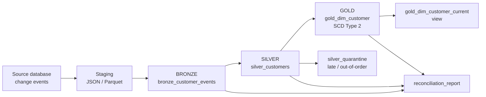

# CDC + SCD Type 2 Lakehouse

A change-data-capture platform that streams database changes into a Delta Lakehouse and keeps full history with Slowly Changing Dimensions Type 2 — on Azure Databricks with PySpark and Delta Lake.

[](https://www.databricks.com/)
[](https://delta.io/)
[](https://www.python.org/)

## The problem

Operational databases change constantly: a customer moves city, upgrades tier, corrects an email, or is deleted. Reporting that reads only the latest row loses history — you cannot answer "what tier was this customer on last quarter?" or "when did this record change?" — and a pipeline that re-reads the whole source table on every run is slow, expensive, and still misses changes between runs.

This project solves that with change data capture (CDC): it consumes only the changes, applies them in source order, and maintains a full, auditable history of every customer record.

## What it proves

- **Exactly-once ingestion** — duplicate deliveries of the same change event are deduplicated; re-running a notebook never double-applies a change.
- **Full history** — every real attribute change opens a new SCD Type 2 version; unchanged updates open nothing; deletes close the current version instead of erasing it.
- **Late data handled, not lost** — events arriving after the watermark are quarantined for review, never silently dropped or applied out of order.
- **Correctness measured, not asserted** — every run ends with a reconciliation report comparing source, Bronze, Silver, and Gold counts plus a hash check, and the run fails loudly if any check fails.

## Architecture



Medallion flow:

| Layer | Table | Purpose |
|---|---|---|
| Bronze | `bronze_customer_events` | Raw change events exactly as received, plus ingestion metadata only. Append-only. |
| Silver | `silver_customers` | Deduplicated, watermarked, ordered change events ready to apply. |
| Silver | `silver_quarantine` | Late or out-of-order events held for review — never silently dropped. |
| Gold | `gold_dim_customer` | SCD Type 2 dimension: one row per version of a customer, with `valid_from`, `valid_to`, `is_current`. |
| Gold | `gold_dim_customer_current` | View over the Gold table: only the current version of each customer. |
| Gold | `reconciliation_report` | One row per check per run, with PASS / FAIL. |

All tables live in catalog `main`, schema `cdc_lakehouse`.

## Source data

The source domain is customer records. Each change event carries:

| Column | Description |
|---|---|
| `customer_id` | Business key — stable across all versions of a customer. |
| `full_name`, `email`, `city`, `tier` | Tracked attributes; a change to any of these opens a new SCD Type 2 version. |
| `loyalty_points` | Added mid-stream as a schema-evolution example; absent (null) in earlier events. |
| `updated_at` | Timestamp of the change in the source system. |
| `operation` | `INSERT`, `UPDATE`, or `DELETE`. |
| `seq` | Monotonic source sequence number — the ordering authority. |
| `source_ts` | Timestamp the event was produced. |

See [`docs/data_dictionary.md`](docs/data_dictionary.md) for the full table and column reference.

A 30-row excerpt of the generated events is in [`data/sample_cdc_events.csv`](data/sample_cdc_events.csv), so the input shape can be inspected without running anything. It includes inserts, an update that changes city and tier, a no-op update (same attributes, new `seq`), a duplicate delivery of `seq` 203, two deletes, a re-registration after a delete, `loyalty_points` appearing only from `seq` 401 onwards (schema evolution), and a late-arriving update for `CUST-0001` delivered last with a low `seq`.

## Run order

Run the notebooks in order. Each notebook is idempotent — re-running it does not duplicate data or double-apply a change.

| # | Notebook | What it does |
|---|---|---|
| 01 | `notebooks/01_generate_source_data.py` | Generates deterministic synthetic CDC events and writes them to staging. |
| 02 | `notebooks/02_bronze_ingestion.py` | Ingests staged events into Bronze, with a processed-files guard. |
| 03 | `notebooks/03_silver_dedup.py` | Deduplicates by `seq`, applies the watermark, quarantines late events. |
| 04 | `notebooks/04_gold_scd2.py` | Applies changes to the Gold SCD Type 2 dimension and rebuilds the current view. |
| 05 | `notebooks/05_reconciliation_and_quality.py` | Runs count and hash checks, writes `reconciliation_report`, fails loudly on any FAIL. |

After a full run, `gold_dim_customer_current` is ready for reporting, and `reconciliation_report` shows whether the run was correct.

## Reconciliation approach

Notebook 05 checks, for every run:

1. Source event count vs Bronze row count — nothing lost in ingestion.
2. Bronze row count vs Silver + quarantine row count — every event is either applied or quarantined, none dropped.
3. Silver applied events vs Gold versions opened/closed — every applied change is reflected in history.
4. Gold current-row count vs distinct business keys alive — one current row per live customer.
5. Hash comparison on a sample of business keys between Silver and Gold current rows — attribute values agree.

Each check is written to `reconciliation_report` with `PASS` or `FAIL`. A `FAIL` raises an exception, so a bad run is never silent. Record real runs in [`results/reconciliation_template.md`](results/reconciliation_template.md).

## Design decisions

The reasoning behind the key choices is recorded as Architecture Decision Records in [`docs/adr/`](docs/adr/):

- [ADR-001](docs/adr/ADR-001-merge-vs-overwrite.md) — MERGE vs overwrite for applying changes
- [ADR-002](docs/adr/ADR-002-scd2-vs-scd1.md) — SCD Type 2 vs Type 1 for customer history
- [ADR-003](docs/adr/ADR-003-watermark-and-late-data.md) — Watermarking and late-data handling
- [ADR-004](docs/adr/ADR-004-delta-lake-format.md) — Delta Lake as the storage format

Full architecture, the SCD Type 2 algorithm step by step, failure modes, and testing approach: [`docs/architecture.md`](docs/architecture.md).

## How to run

1. Create the schema and a staging Volume in your Databricks workspace. The notebooks use catalog `main`, schema `cdc_lakehouse`; edit the `CATALOG` / `SCHEMA` variables at the top of each notebook if your workspace uses different names.
2. Run notebook `01` to generate the synthetic source events into staging.
3. Run notebooks `02`–`05` in order.
4. Query `main.cdc_lakehouse.gold_dim_customer_current` for current customers, `main.cdc_lakehouse.gold_dim_customer` for full history, and `main.cdc_lakehouse.reconciliation_report` for the run's checks.

Requirements: Databricks with Delta Lake enabled, PySpark. See [`requirements.txt`](requirements.txt).

## Limits — read before quoting results

- **The source data is synthetic, generated sample data.** It is deterministic and seeded so runs are reproducible, but it is not production data.
- **No production results are claimed.** No runtime, throughput, speedup, or scale figures are stated anywhere in this repository, and none should be quoted from it. Measure results on your own cluster and record them in `results/`.
- **The notebooks were syntax-checked only and have not been run on Databricks.** They are written against the documented Delta Lake / PySpark APIs; run them in your own workspace and treat the first run as a validation run.
- The sample data file `data/sample_cdc_events.csv` shows the input shape only; it is a 30-row excerpt, not the full generated dataset.

## Project structure

```
.
├── README.md
├── docs/
│   ├── architecture.md
│   ├── data_dictionary.md
│   └── adr/
│       ├── ADR-001-merge-vs-overwrite.md
│       ├── ADR-002-scd2-vs-scd1.md
│       ├── ADR-003-watermark-and-late-data.md
│       └── ADR-004-delta-lake-format.md
├── notebooks/
│   ├── 01_generate_source_data.py
│   ├── 02_bronze_ingestion.py
│   ├── 03_silver_dedup.py
│   ├── 04_gold_scd2.py
│   └── 05_reconciliation_and_quality.py
├── data/
│   └── sample_cdc_events.csv
├── results/
│   └── reconciliation_template.md
├── requirements.txt
├── .gitignore
└── LICENSE
```

## Author

**Sanjeev Kumar Pandey** — Data Engineer → AI Engineer, Azure Databricks · PySpark · Delta Lake · RAG · Agentic AI

- GitHub: https://github.com/sanjeevpandeydata
- LinkedIn: https://www.linkedin.com/in/sanjeev-pandey-7a45831ba

## License

MIT — see [`LICENSE`](LICENSE).
